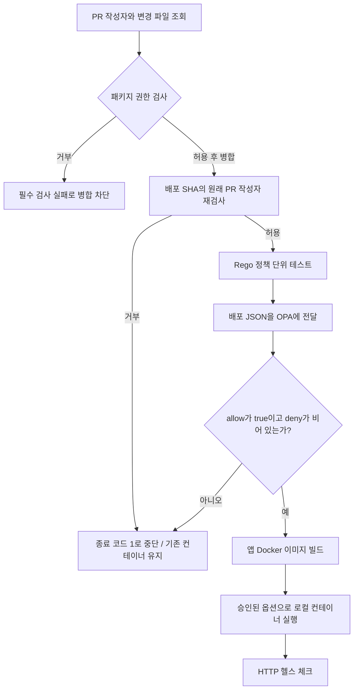

# OPA로 실습하는 로컬 Docker CI/CD

OPA(Open Policy Agent)를 **배포 전에 규칙을 검사하는 정책 엔진**으로 사용하는 실습입니다.
공식 OPA 소스를 개발하거나 컴파일하지 않고, 버전과 digest가 고정된 OPA Docker 이미지를 실행합니다.

핵심은 **배포하려는 설정을 OPA에 전달하고, 허용된 경우에만 Docker 배포를 실행하는 것**입니다.
OPA가 직접 배포하지는 않습니다. 실제 빌드와 배포는 이 프로젝트의 Node.js 실행기가 담당합니다.

현재 예제 앱은 `wcnaf/services/frontend`에서 복사한 React/Vite 프로젝트입니다.
원본은 보존하고 [frontend/package.json](frontend/package.json), `src`, 정적 파일, 잠금 파일 등을 가져왔습니다.
`.env`, `node_modules`, `dist`, 개발 도구 백업은 제외했습니다.
이 프로젝트의 `shared`는 npm 패키지가 아니라 **FSD 레이어인 `frontend/src/shared/`**입니다.

## 전체 흐름



정책 테스트가 실패하거나 JSON 파싱, OPA 실행, Docker 실행 중 오류가 발생해도 작업은 중단됩니다.
판단할 수 없는 입력을 허용하지 않는 **fail-closed** 방식입니다.

## 준비 사항

- Docker Desktop: Linux 컨테이너 엔진을 실행합니다.
- Node.js 22 이상: 컨테이너와 GitHub Actions에서는 Node 24를 사용합니다.
- 최초 Docker 이미지 다운로드를 위한 인터넷 연결이 필요합니다.

루트 실행기에는 추가 npm 의존성이 없어 호스트의 `npm install`은 필요 없습니다.
프런트엔드 의존성은 Docker 빌드 중 `npm ci`로 설치합니다.
호스트에 OPA나 Go를 설치하거나, 클라우드 계정과 별도 WSL 배포판을 준비할 필요도 없습니다.
아래 명령은 모두 이 저장소의 루트 폴더에서 실행합니다.

## 파일별 역할

| 파일 | 정의된 내용 | 언제 수정하나요? |
| --- | --- | --- |
| [policy/access.rego](policy/access.rego) | `shared`와 권한 제어 파일을 멤버만 변경하도록 하는 PR/CD 공통 정책 | 변경 가능한 범위를 바꿀 때 |
| [policy/members.json](policy/members.json) | 멤버 GitHub 로그인 목록. 기본값은 `leeggmin` | 멤버를 추가/삭제할 때 |
| [policy/access_test.rego](policy/access_test.rego) | 멤버/비멤버, 이름 변경, 우회와 누락 입력 테스트 | 권한 정책을 수정할 때 |
| [scripts/access.mjs](scripts/access.mjs) | 실제 GitHub 작성자·변경 파일 수집과 PR/CD 권한 검사 | GitHub 연결이나 신원 수집을 바꿀 때 |
| [scripts/access.test.mjs](scripts/access.test.mjs) | 원작성자 추적, 직접 push와 불완전한 메타데이터 차단 테스트 | 입력 수집을 수정할 때 |
| [examples/access/member-shared.json](examples/access/member-shared.json) | 멤버의 `shared` 변경 예제 | 허용 실습 |
| [examples/access/nonmember-feature.json](examples/access/nonmember-feature.json) | 비멤버의 일반 기능 변경 예제 | 허용 실습 |
| [examples/access/nonmember-shared.json](examples/access/nonmember-shared.json) | 비멤버의 `shared` 변경 예제 | 차단 실습 |
| [frontend/src](frontend/src) | `app`, `pages`, `features`, `entities`, `shared`의 실제 원본 코드 | 실제 프런트엔드를 수정할 때 |
| [policy/deploy.rego](policy/deploy.rego) | 배포 허용 규칙, 거부 이유인 `deny`, 최종 결과인 `allow` | 배포 규칙을 추가하거나 바꿀 때 |
| [policy/deploy_test.rego](policy/deploy_test.rego) | 정상·위험·필드 누락·잘못된 타입에 대한 정책 테스트 | 정책을 바꾸고 의도대로 동작하는지 확인할 때 |
| [deploy/development.json](deploy/development.json) | 기본 배포 요청: 이미지, 포트, 보안 옵션 등 | 배포하려는 설정을 바꿀 때 |
| [deploy/denied-latest.json](deploy/denied-latest.json) | `latest` 태그 때문에 거부되는 예제 | 이미지 태그 규칙의 차단 결과를 볼 때 |
| [deploy/denied-privileged.json](deploy/denied-privileged.json) | `privileged: true` 때문에 거부되는 예제 | 권한 관련 차단 결과를 볼 때 |
| [scripts/lab.mjs](scripts/lab.mjs) | OPA 실행, 결과 확인, 이미지 빌드, 컨테이너 배포·검증·종료 | 검사와 배포를 연결하는 실행 흐름을 바꿀 때 |
| [app/server.mjs](app/server.mjs) | 프런트엔드 정적 파일과 SPA 경로, `/health`, `/api/info` 제공 | 정적 파일 제공 방식을 바꿀 때 |
| [Dockerfile](Dockerfile) | 프런트엔드 빌드와 non-root 정적 서버의 다단계 이미지 | 이미지 구성이나 앱 시작 방법을 바꿀 때 |
| [package.json](package.json) | `npm test`, `npm run lab:deploy` 등의 명령 별칭 | 명령을 추가하거나 바꿀 때 |
| [.github/workflows/ci.yml](.github/workflows/ci.yml) | GitHub Actions에서 실행할 검사·임시 배포 순서 | PR이나 push 시 자동 실행할 절차를 바꿀 때 |
| [.vscode/tasks.json](.vscode/tasks.json) | VS Code 작업 메뉴에서 실행할 명령 | 에디터 작업 메뉴를 바꿀 때 |
| [.dockerignore](.dockerignore) | 앱·프런트엔드 소스만 빌드에 포함하고 비밀 환경 파일·의존성 제외 | 이미지에 추가 파일이 필요할 때 |
| [.gitignore](.gitignore) | 로그, 로컬 환경 파일 등의 Git 제외 규칙 | 저장소에 올리지 않을 파일을 지정할 때 |
| [.gitattributes](.gitattributes) | Windows와 Linux에서 사용할 LF 줄바꿈 규칙 | 저장소의 텍스트 저장 형식을 관리할 때 |

**먼저 배포 JSON, 그다음 Rego 정책, 마지막으로 실행기를 읽으면 흐름을 이해하기 쉽습니다.**
배포 JSON은 이 실습에서 만든 입력 형식이며, Docker Compose 파일이 아닙니다.

## shared 변경 권한과 두 번의 차단

| 작성자 | 변경 경로 | PR 검사 | 배포 전 검사 |
| --- | --- | --- | --- |
| 멤버 | `frontend/src/shared/**` | 허용 | 허용 |
| 비멤버 | `frontend/src/shared/**` | 거부 | 거부 |
| 멤버/비멤버 | `frontend/src/features/**`, `pages/**`, `entities/**` 등 | 허용 | 허용 |
| 비멤버 | `policy/**`, `scripts/**`, `deploy/**`, `.github/**` 등 권한 제어 파일 | 거부 | 거부 |

마지막 행은 정책·워크플로를 수정해 우회하는 것을 막기 위한 보호입니다.
삭제도 변경으로 검사하고, `shared` 파일을 다른 폴더로 옮긴 경우 이전 경로도 검사합니다.
작성자·변경 파일·멤버 목록이 없거나 올바르지 않으면 거부합니다.

여기서 **멤버는 GitHub 조직의 자동 조회 결과가 아니라 [policy/members.json](policy/members.json)에 등록한 사용자**입니다.
초기값 `leeggmin`을 필요한 GitHub 로그인으로 바꾸세요. 대소문자는 구분하지 않습니다.

1. **PR 단계**: GitHub API에서 PR 원작성자와 모든 변경 파일을 가져와 기준 브랜치의 정책·멤버 목록으로 검사합니다.
2. **배포 단계**: 실제 배포 커밋 SHA와 연결된 병합 PR을 조회하고, 병합자가 아닌 **원래 PR 작성자**를 다시 검사합니다.
3. 실제 `lab:deploy` 함수도 빌드 직전에 같은 권한 검사를 반복합니다. 권한 입력이 없으면 실행하지 않습니다.

권한 주석은 [.github/workflows/ci.yml](.github/workflows/ci.yml)의 `1차 PR 차단`, `2차 배포 차단`과
[scripts/lab.mjs](scripts/lab.mjs)의 `CD gate` 부분에 있습니다.

## 배포 입력과 현재 정책

기본 입력은 [deploy/development.json](deploy/development.json)입니다.

| 필드 | 허용 값·조건 | 배포에서의 의미 |
| --- | --- | --- |
| `service` | `opa-lab` | 이 실습에서 관리하는 고정 컨테이너 이름 |
| `image` | `opa-cicd-demo:1.0.0` 같은 명시적 태그, `latest` 금지 | 빌드하고 실행할 이미지 이름 |
| `environment` | `development` 또는 `staging` | 정책 검사용 구분값. 별도 환경이나 서버를 만들지는 않음 |
| `replicas` | `1` | 이 실습은 컨테이너 하나만 실행 |
| `host_port` | 1024~65535 범위의 정수, 기본 `18080` | PC의 `127.0.0.1`에 공개할 포트 |
| `container_port` | `8080` | 앱이 컨테이너 내부에서 사용하는 포트 |
| `privileged` | `false` | privileged 컨테이너 금지 |
| `run_as_user` | `1000` | `--user 1000:1000`으로 non-root 실행 |
| `read_only` | `true` | `--read-only` 적용 |
| `cap_drop` | `["ALL"]` | `--cap-drop ALL`로 Linux capability 제거 |
| `no_new_privileges` | `true` | 권한 상승 방지 옵션 적용 |

필수 필드가 빠지거나 값의 타입이 다르면 거부합니다.
실행기는 설정을 한 번 읽고, **OPA가 검사한 바로 그 객체**로 Docker 옵션을 구성합니다.
메모리 128MiB, CPU 0.5개, PID 64개 제한도 실행기에서 고정 적용합니다.

## 지금부터 해볼 순서

### 1. 정책 자체가 맞는지 테스트

```powershell
npm test
```

Node 메타데이터 수집 테스트 6개와 Rego 테스트 14개가 통과해야 합니다.
정상 설정을 허용하고 위험한 설정, 필드 누락, 잘못된 타입을 거부하는지 확인합니다.
이 명령은 앱을 배포하지 않습니다.

### 2. 배포 요청의 허용·거부 결과 확인

```powershell
npm run lab:check
npm run lab:negative
npm run access:check -- examples/access/member-shared.json
npm run access:check -- examples/access/nonmember-feature.json
npm run access:check -- examples/access/nonmember-shared.json
```

`lab:check`는 기본 배포 JSON에 대해 `allow: true`, `deny: []`를 출력해야 합니다.
`lab:negative`는 위험 예제 두 개가 모두 명시적으로 거부될 때 성공합니다.
Docker나 OPA 실행 오류를 정상적인 정책 거부로 취급하지 않습니다.
`access:check`의 앞 두 예제는 PR/CD에서 모두 허용되고, 마지막 비멤버 `shared` 예제는 종료 코드 1로 거부됩니다.
이 로컬 JSON의 `actor`는 **시뮬레이션용**입니다. 실제 CI는 이 값을 신뢰하지 않고 GitHub API에서 수집합니다.

### 3. 허용된 설정으로 실제 로컬 배포

```powershell
npm run lab:deploy:member
npm run lab:status
npm run lab:verify
```

`lab:deploy:member`는 멤버의 shared 변경 입력으로 권한 검사와 배포 검사를 통과한 뒤 프런트엔드를 빌드·실행합니다.
비멤버의 다른 패키지 변경 배포는 `npm run lab:deploy:guest`로 확인할 수 있습니다.
일반 명령을 직접 실행하려면 권한 입력을 지정해야 합니다.

```powershell
npm run lab:deploy -- deploy/development.json examples/access/member-shared.json
```

- 앱 응답: http://127.0.0.1:18080
- 헬스 체크: http://127.0.0.1:18080/health
- 배포 메타데이터: http://127.0.0.1:18080/api/info

여기서 실행되는 앱은 OPA 서버가 아니라 복사한 실제 프런트엔드입니다.
원본의 백엔드는 포함하지 않았으므로 로그인·업무 API 기능은 별도 백엔드 없이는 동작하지 않습니다.
OPA는 검사할 때만 일회성 컨테이너로 실행되고 제거됩니다.
앱 컨테이너 `opa-lab`은 종료 명령을 실행할 때까지 유지됩니다.

포트 18080이 사용 중이면 기본 배포 JSON의 `host_port`를 비어 있는 허용 범위 포트로 변경합니다.
앱은 localhost에만 바인딩하므로 다른 PC에서는 접근할 수 없습니다.

### 4. 위험한 설정이 배포 전에 차단되는지 확인

```powershell
npm run lab:deploy -- deploy/development.json examples/access/nonmember-shared.json
npm run lab:deploy -- deploy/denied-latest.json examples/access/member-shared.json
npm run lab:deploy -- deploy/denied-privileged.json examples/access/member-shared.json
```

이 세 명령은 **종료 코드 1로 실패하는 것이 정상**입니다.
각각 비멤버 shared 변경, `latest` 태그, privileged 설정에 대한 거부 이유가 표시됩니다.
이미지 빌드나 컨테이너 교체에 진입하지 않으므로 기존 정상 컨테이너는 유지됩니다.

### 5. 직접 설정과 정책 변경

우선 기본 배포 JSON의 `image`를 `opa-cicd-demo:latest`로 바꾸고 `npm run lab:check`를 실행해 보세요.
거부를 확인한 뒤 `opa-cicd-demo:1.0.0`으로 복구하면 다시 허용됩니다.

그다음 프런트엔드 파일을 수정하고 `npm run lab:deploy:member`를 실행하면 수정한 앱이 다시 빌드·배포됩니다.
정책 자체를 바꾸려면 Rego 파일과 테스트를 함께 수정하고 `npm test`로 검증합니다.
정책을 완화한다고 실행기에 없는 배포 기능이 자동으로 추가되지는 않습니다.

### 6. 실습 종료

```powershell
npm run lab:down
```

이 실습의 라벨이 붙은 `opa-lab` 컨테이너만 제거합니다.
Docker 이미지, 볼륨, 다른 컨테이너는 삭제하지 않습니다.
다시 시작하려면 `npm run lab:deploy:member`를 실행합니다.

VS Code에서는 명령 팔레트의 `Tasks: Run Task`에서 `OPA lab:` 작업을 선택해도 됩니다.
검사·배포 작업에서는 기본 입력 또는 거부 예제 중 하나를 선택할 수 있습니다.

## GitHub CI에서 확인하는 방법

원격 저장소는 https://github.com/leeggmin/opa 이고, Git 원격 이름은 `origin`입니다.
공식 OPA의 fork가 아니며, 공식 소스나 Git 이력도 포함하지 않습니다.

워크플로를 먼저 신뢰하는 `main`에 반영해야 이후 PR부터 새 검사가 동작합니다.
`pull_request_target`의 `PR package access` 작업은 **기준 브랜치만 checkout**하고 PR 코드를 실행하지 않습니다.
읽기 전용 토큰으로 GitHub API 메타데이터만 가져오며, PR이 자기 멤버 목록과 정책을 바꾸어 통과할 수 없습니다.

**GitHub에서 직접 필요한 설정**:

1. 저장소 `Settings → Rules → Rulesets` 또는 `Branches`에서 `main` 보호 규칙을 만듭니다.
2. PR을 통한 변경을 필수로 지정합니다.
3. 필수 상태 검사에 **`PR package access`**를 추가하고, 최신 기준 브랜치와 동기화하도록 설정합니다.
4. 직접 push와 우회 권한을 제한합니다. 필요하면 관리자도 우회할 수 없게 설정합니다.

상태 검사가 실패하는 것만으로는 PR 생성이나 병합을 강제로 막지 못합니다. 위 보호 설정이 있어야 **병합**이 차단됩니다.
이 설정은 저장소 관리 권한이 필요하므로 코드만으로 자동 적용하지 않았습니다.

`main` push/수동 실행의 `Frontend deployment gate` 작업은 해당 SHA의 병합 PR을 찾아 원작성자 권한을 재검사합니다.
권한 검사 → 정책 테스트 → Docker 설정 검사 → 프런트엔드 빌드·배포 → 헬스 체크 → 컨테이너 정리 순서입니다.
연결된 병합 PR이 없는 직접 push(최초 설정 반영 포함)는 의도적으로 배포를 거부합니다.
일반 merge/squash 병합을 사용하세요. 여러 PR이 모호하게 연결되거나 rebase 결과로 SHA를 추적할 수 없으면 거부합니다.
GitHub 변경 파일 API의 최대 3000개를 초과하거나 메타데이터가 불완전해도 거부합니다.

실제 CI에는 `.opa/access-context.json`을 GitHub 수집기가 생성하고 `OPA_ACCESS_CONTEXT`로 전달합니다.
저장소에 커밋한 예제 JSON을 실제 신원 대신 사용하지 않으며, 배포 SHA와 일치하는 입력만 허용합니다.
멤버 목록 변경은 기존 PR 검사를 자동 재실행하지 않으므로 목록 변경 뒤 열린 PR의 검사를 다시 실행하세요.
배포에서는 최신 `main`의 목록으로 다시 검사합니다.

배포 전 검사가 실패하면 이미지 빌드와 컨테이너 교체에 진입하지 않습니다.
push 후 저장소의 [Actions 탭](https://github.com/leeggmin/opa/actions)에서 결과와 단계별 로그를 확인합니다.
첫 push 시 GitHub 저장소에 Actions가 활성화되어 있어야 자동 실행됩니다.

**GitHub Actions는 사용자 PC에 배포하지 않습니다.** GitHub의 임시 실행 환경에서 배포를 재현하고 제거할 뿐이며,
이미지를 레지스트리에 올리거나 클라우드 서버에 배포하지도 않습니다.
따라서 지금 구성은 로컬 배포와 CI 검증을 배우는 실습이지, 외부 서버에 계속 서비스를 유지하는 운영 CD는 아닙니다.

## 주의 사항

- OPA는 이 실행기 안에서 배포를 검사합니다. Docker 접근 권한이 있으면 직접 Docker 명령을 실행해 우회할 수 있으므로, 강제 admission controller는 아닙니다.
- `latest`를 금지해도 다른 태그가 불변이 되는 것은 아닙니다. 운영에서는 배포 이미지 digest 고정도 검토해야 합니다.
- OPA 도구 이미지는 digest가 고정되어 있지만, Node 베이스 이미지는 메이저 버전 태그를 사용합니다.
- 실제 운영 적용 전에는 정책·워크플로 변경에 대한 리뷰와 보호 규칙이 필요합니다. 신뢰하지 않는 PR 코드는 운영 비밀값이나 배포 권한이 없는 격리된 러너에서만 실행해야 합니다.
- 재배포는 이미지 빌드 성공 후 기존 실습 컨테이너를 제거하고 교체합니다. 무중단 배포나 시작 실패 시 자동 롤백은 구현되어 있지 않습니다.